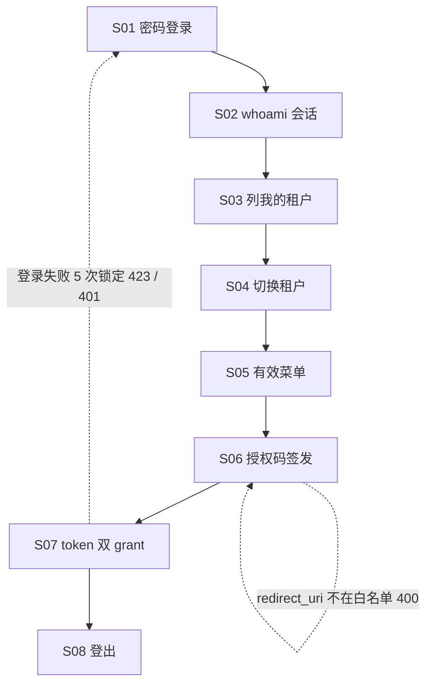

# 流程与功能对齐 — SaaS 身份平台 Kotlin/Ktor 端

> 人填、人评审。机器只检查引用的功能 ID 是否存在。
> 评审时把流程图投出来，逐行念「这一步靠哪些功能完成」。念不出来的行，
> 要么流程是空的，要么功能是缺的。这就是对齐的全部意义。

## FLOW-01 身份会话主流程（登录→会话→租户→菜单→OAuth 签发）

| 步骤 | 名称 | 角色 | 输入 | 输出 | 状态流转 | 支撑功能子项 |
|---|---|---|---|---|---|---|
| S01 | 密码登录 | 客户端 | email+password | access_token+refresh_token+availableTenants | 连续 5 次错→locked_until→423 空体 | M01.F04.I01 |
| S02 | whoami 会话 | 已登录 | Bearer access_token | id/email/displayName | — | M01.F01.I01 |
| S03 | 列我的租户 | 已登录 | clientId | 成员关系列表 | — | M01.F03.I01 |
| S04 | 切换租户 | 成员 | tenantId | 携新 tenant claim 的 token 对 | — | M01.F03.I02 |
| S05 | 有效菜单 | 成员 | clientId+tenantId | 菜单树 | — | M04.F04.I08 |
| S06 | 授权码签发 | lab 等 client 应用 | clientId+redirect_uri+Bearer | 一次性 code（5min） | code: 签发→消费 | M04.F03.I01 |
| S07 | token 双 grant | lab 等 client 应用 | code 或 refresh_token | access_token（+轮换 refresh） | refresh: 旧→轮换新 | M04.F03.I02 |
| S08 | 登出 | 已登录 | Bearer | 200 成功（本地 no-op，全局 SSO 归 IdP 面） | 会话终止 | M01.F04.I06 |

### 评审时问这四个问题

1. 有没有哪个步骤的「支撑功能子项」是空的？→ 功能缺失，或这一步不该存在
2. 有没有功能子项从头到尾没出现在任何流程里？→ 见下方孤儿清单
3. 状态流转列里的状态名，和代码里的枚举一致吗？→ 不一致就是两套真相
4. 退回路径都画了吗？→ 只画正向流程，会漏掉一半功能

### 孤儿功能

不在任何流程里但合法的功能。**没解释的孤儿 = 没人要的功能。**

| 功能 ID | 为什么合法 |
|---|---|
| M01.F04.I06 | 登出是无状态 JWT 的终端清理动作，独立于 FLOW-01 正向链路（fastapi sessions_logout 镜像） |

---

## FLOW-02 认证异常流程

> 异常流程单独成表，否则它承载的功能永远是孤儿。

| 步骤 | 名称 | 触发条件 | 响应 | 支撑功能子项 |
|---|---|---|---|---|
| E01 | 登录失败锁定 | 连续 5 次密码错 | 423 空体（15 分钟窗口，不泄露存在性） | M01.F04.I01 |
| E02 | 凭据错误 | 密码不符 | 401（与不存在同语义） | M01.F04.I01 |
| E03 | 授权码非法/过期/已消费 | code 校验失败 | 400 invalid_grant | M04.F03.I02 |
| E04 | refresh_token 轮换重放 | 旧 refresh 复用 | 401（rotate-once） | M04.F03.I02 |

---

## FLOW-03 管理面巡检流程（平台 admin 巡检租户）

> 管理面单独成表：租户列表是平台 admin 视角的管理面读取，不在终端用户身份链路里。

| 步骤 | 名称 | 角色 | 输入 | 输出 | 支撑功能子项 |
|---|---|---|---|---|---|
| A01 | 租户巡检 | 平台 admin | admin Bearer + 分页/名称/状态过滤 | 租户分页列表 | M00.F01.I01 |
